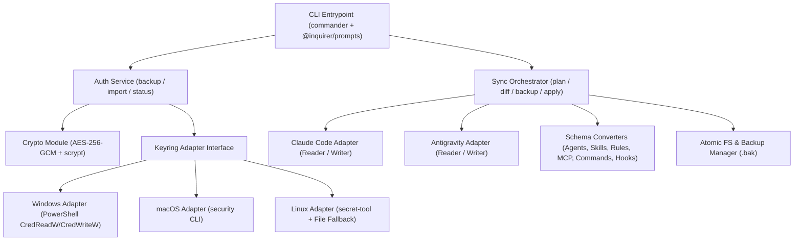

# Kiến Trúc Tổng Thể Hệ Thống (System Architecture)

## 1. Sơ Đồ Kiến Trúc Module

## 2. Phân Tầng Trách Nhiệm

| Tầng / Module | Đường dẫn dự kiến | Trách nhiệm |
| :--- | :--- | :--- |
| **CLI Layer** | `src/cli/` | Parse subcommands/flags, chạy interactive wizard/checkbox khi thiếu tham số, định dạng bảng kết quả. |
| **Auth Layer** | `src/auth/` | Đọc/ghi OAuth JSON payload, giải mã metadata JWT `id_token`, mã hóa/giải mã AES-256-GCM, validate schema import. |
| **Keyring Adapters** | `src/auth/keyring/` | Trừu tượng hóa đọc/ghi credential `gemini:antigravity` theo HĐH và fallback `~/.gemini/antigravity-cli/antigravity-oauth-token`. |
| **Sync Engine** | `src/sync/` | Lập kế hoạch đồng bộ (Plan), phát hiện xung đột (Conflict Detection), sinh diff preview, tạo `.bak`, thực thi ghi nguyên tử và xuất báo cáo. |
| **Platform Adapters** | `src/adapters/` | Đọc/ghi cấu trúc thư mục và tệp theo từng nền tảng (`claude` và `antigravity`) ở cả mode `project` và `global`. |
| **Converters** | `src/converters/` | Chuyển đổi trung gian 2 chiều (Intermediate Representation hoặc cặp converter đối xứng) cho 6 nhóm cấu hình. |
| **Core Utilities** | `src/core/` | Atomic file write, permission `0o600`, logger ẩn bí mật, mã lỗi chuẩn từ [Conventions](../00_common/conventions.md). |

## 3. Luồng Dữ Liệu Tổng Quát

### 3.1. Auth Backup & Import
1. `auth backup`: Keyring Adapter đọc JSON UTF-8 từ `gemini:antigravity` (hoặc fallback file) -> Auth Service trích `email` hiển thị từ `id_token` -> (Tùy chọn `--encrypt`) mã hóa AES-256-GCM -> ghi 1 tệp JSON duy nhất.
2. `auth import`: Đọc tệp JSON đầu vào -> tự nhận diện plain hay encrypted (nhập passphrase nếu `encrypted: true`) -> validate cấu trúc `{ token, auth_method, id_token }` -> Keyring Adapter ghi vào `gemini:antigravity` (hoặc fallback file).

### 3.2. Agent Config Sync
1. Resolve mode (`project` hoặc `global`), hướng (`claude -> agy` hoặc `agy -> claude`), và danh sách nhóm cấu hình (qua `--categories` hoặc checkbox tương tác).
2. Source Adapter đọc dữ liệu thực tế từ hệ thống tệp nguồn -> Converter chuyển sang định dạng đích kèm danh sách cảnh báo/mục bỏ qua.
3. Sync Engine đối chiếu với hệ thống tệp đích để phân loại: `create`, `update` (conflict), `unchanged`, `skipped`.
4. Nếu không ở `--dry-run`, hiển thị preview xung đột để người dùng chọn (hoặc áp dụng `--force`/`--skip-existing`), tạo `.bak` cho mọi tệp bị ghi đè, thực thi ghi nguyên tử và in bảng tổng hợp.
