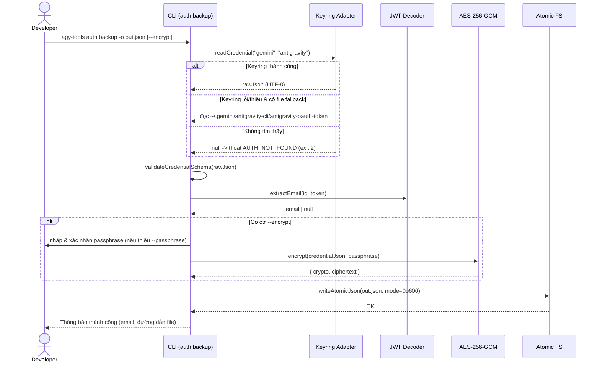
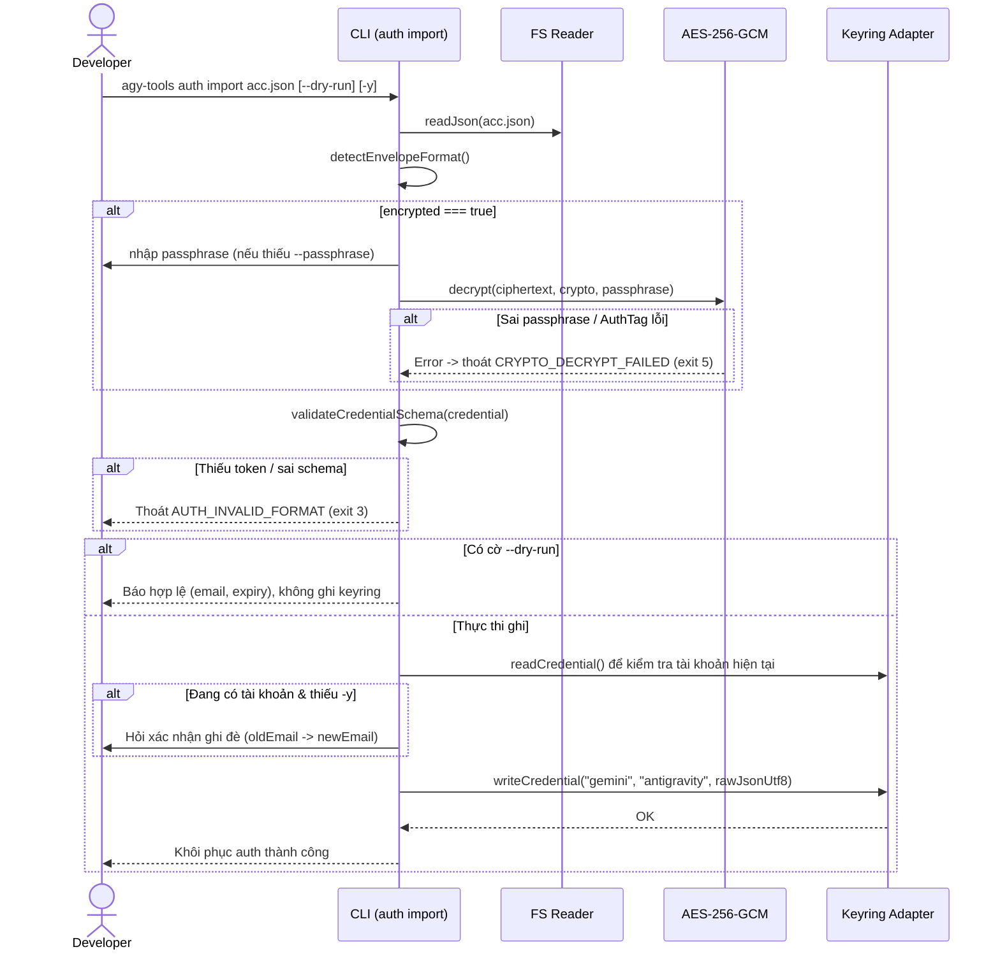

# Thiết Kế Chi Tiết: Backup & Import Auth Của `agy` CLI

Tài liệu đặc tả yêu cầu: [Auth Backup & Import Spec](./spec.md).

## 1. Biểu Đồ Tuần Tự (Sequence Diagrams)

### 1.1. Luồng Backup (`agy-tools auth backup`)

### 1.2. Luồng Import (`agy-tools auth import`)

## 2. Cơ Chế Keyring Đa Nền Tảng

### 2.1. Windows (`win32`)
- Thực thi `powershell.exe -NoProfile -NonInteractive -Command -` và truyền script C# `Add-Type` qua stdin (tránh giới hạn độ dài dòng lệnh và không để lộ token trong process arguments).
- Truyền payload cần ghi qua biến môi trường tạm của tiến trình con (`AGY_TOOLS_CRED_PAYLOAD`) hoặc `stdin`, tuyệt đối không nội suy trực tiếp chuỗi JSON token vào mã nguồn C# để tránh lỗi escape hoặc rò rỉ.
- Tham số Win32 `CREDENTIALW`:
  - `Type = 1` (`CRED_TYPE_GENERIC`)
  - `TargetName = "gemini:antigravity"`
  - `UserName = "antigravity"`
  - `Persist = 2` (`CRED_PERSIST_LOCAL_MACHINE`)
  - `CredentialBlob`: mảng byte `Encoding.UTF8.GetBytes(jsonPayload)`

### 2.2. macOS (`darwin`)
- **Đọc:** `security find-generic-password -s gemini -a antigravity -w`
- **Ghi:** `security add-generic-password -U -s gemini -a antigravity -w <payload>` (lưu ý `-U` cho phép cập nhật mục đã tồn tại; nếu dùng `stdin`/interactive security prompt hoặc `execFile` không qua shell để tránh lộ qua shell history).

### 2.3. Linux (`linux`) & Fallback
- Kiểm tra sự tồn tại của `secret-tool` (`which secret-tool`) và `DBUS_SESSION_BUS_ADDRESS`.
- **Đọc:** `secret-tool lookup service gemini account antigravity`
- **Ghi:** `secret-tool store --label="gemini:antigravity" service gemini account antigravity` với payload truyền qua `stdin`.
- **Fallback:** Khi `secret-tool` không có, D-Bus vắng mặt (Docker/SSH headless), hoặc truyền `--file-fallback`: đọc/ghi trực tiếp `~/.gemini/antigravity-cli/antigravity-oauth-token` (tạo thư mục cha `0o700`, ghi tệp `0o600`).

## 3. Thuật Toán Mã Hóa & Kiểm Tra Hợp Lệ

### 3.1. Mã hóa AES-256-GCM
1. Sinh `salt = crypto.randomBytes(16)` và `iv = crypto.randomBytes(12)`.
2. Dẫn xuất khóa 32 bytes: `key = crypto.scryptSync(passphrase, salt, 32, { N: 16384, r: 8, p: 1 })`.
3. Mã hóa chuỗi JSON của khối `credential` bằng `crypto.createCipheriv('aes-256-gcm', key, iv)`.
4. Lấy `tag = cipher.getAuthTag()` (16 bytes).
5. Giải mã thực hiện đảo ngược các bước trên và bắt ngoại lệ `authTag` không khớp để ánh xạ sang `CRYPTO_DECRYPT_FAILED`.

### 3.2. Trích xuất Metadata Không Nhạy Cảm từ `id_token`
1. Tách `id_token.split('.')`; nếu có đủ 3 phần, base64url-decode phần thứ 2 (`payload`).
2. Parse JSON và lấy `payload.email ?? null`.
3. Lấy `authMethod = credential.auth_method ?? null` và `expiry = credential.token?.expiry ?? null`.

### 3.3. Validation Schema Đầu Vào (`import`)
Chấp nhận 2 dạng đầu vào:
- **Dạng 1 (Wrapped `agy-tools-auth`):** `format === "agy-tools-auth"`, `version === 1`, có `encrypted` (boolean), nếu `encrypted: false` thì có `credential`, nếu `encrypted: true` thì có `crypto` và `ciphertext`.
- **Dạng 2 (Raw `agy` JSON):** object gốc có `token` (object chứa ít nhất một trong `refresh_token` hoặc `access_token`) và `auth_method` (string). Khi import dạng thô, hệ thống ghi trực tiếp chuỗi JSON đã chuẩn hóa vào keyring.
