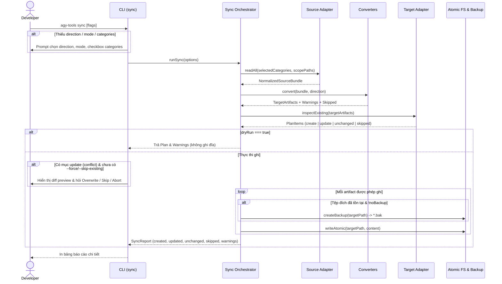

# Thiết Kế Chi Tiết: Đồng Bộ Agents Config Giữa Claude Code & Antigravity

Tài liệu đặc tả yêu cầu: [Agent Config Sync Spec](./spec.md).

## 1. Biểu Đồ Tuần Tự (Sequence Diagram)



## 2. Bảng Ánh Xạ Đường Dẫn (Path Mapping)

### 2.1. Mode `project` (gốc `<root>`)

| Nhóm | Claude Code | Antigravity | Ghi chú |
| :--- | :--- | :--- | :--- |
| **Agents** | `<root>/.claude/agents/*.md` | `<root>/.agents/agents/*.md` | Đệ quy 1 cấp `*.md` |
| **Skills** | `<root>/.claude/skills/<name>/` | `<root>/.agents/skills/<name>/` | Sao chép cả thư mục con (`scripts/`, `references/`, ...) |
| **Rules (Root)** | `<root>/CLAUDE.md` | `<root>/GEMINI.md` | Đọc ngược `agy -> claude`: ưu tiên `GEMINI.md`, fallback `AGENTS.md` |
| **Rules (Modular)** | `<root>/.claude/rules/*.md` | `<root>/.agents/rules/*.md` | Ánh xạ `paths` ↔ `trigger`/`globs` |
| **MCP** | `<root>/.mcp.json` | `<root>/.agents/plugins/project-scope/mcp_config.json` | Kèm `<root>/.agents/plugins/project-scope/plugin.json` |
| **Commands** | `<root>/.claude/commands/**/*.md` | `<root>/.agents/skills/<slug>/SKILL.md` | `git/commit.md` -> `git-commit/SKILL.md` |
| **Hooks** | `<root>/.claude/settings.json` (`hooks`) | `<root>/.agents/hooks.json` | Chỉ sửa nhánh `hooks` trong `settings.json` |

### 2.2. Mode `global` (gốc `$HOME` = `~`)

| Nhóm | Claude Code | Antigravity | Ghi chú |
| :--- | :--- | :--- | :--- |
| **Agents** | `~/.claude/agents/*.md` | `~/.gemini/config/agents/*.md` | Đệ quy 1 cấp `*.md` |
| **Skills** | `~/.claude/skills/<name>/` | `~/.gemini/config/skills/<name>/` | Sao chép trọn gói thư mục skill |
| **Rules (Root)** | `~/.claude/CLAUDE.md` | `~/.gemini/GEMINI.md` | Ánh xạ trực tiếp |
| **Rules (Modular)** | `~/.claude/rules/*.md` | `~/.gemini/config/rules/*.md` | Ánh xạ `paths` ↔ `trigger`/`globs` |
| **MCP** | `~/.claude.json` (`mcpServers`) | `~/.gemini/config/mcp_config.json` (`mcpServers`) | Gộp theo tên server, giữ nguyên phần còn lại của `~/.claude.json` |
| **Commands** | `~/.claude/commands/**/*.md` | `~/.gemini/config/skills/<slug>/SKILL.md` | Chuyển đổi sang skill |
| **Hooks** | `~/.claude/settings.json` (`hooks`) | `~/.gemini/config/hooks.json` | Gộp nhánh `hooks` vào `settings.json` |

## 3. Quy Tắc Chuyển Đổi Schema Chi Tiết

### 3.1. Agents / Subagents (`agents/*.md`)

**Bảng ánh xạ Tool:**

| Claude Code Tool | Antigravity Tool |
| :--- | :--- |
| `Read`, `Glob`, `Grep` | `read_file` |
| `Edit`, `MultiEdit` | `edit_file` |
| `Write` | `write_file` |
| `Bash` | `run_command`, `manage_task` |
| `WebSearch`, `WebFetch` | `search_web` |

**Chuyển đổi `claude -> agy`:**
1. `name`: giữ frontmatter `name`, fallback tên tệp không đuôi `.md`.
2. `description`: giữ frontmatter `description`, fallback đoạn văn đầu tiên (nếu rỗng -> thêm cảnh báo).
3. Đặt `subagent: true`, `mainAgent: false`.
4. `tools`: nếu Claude bỏ trống `tools` (tương đương toàn quyền), gán `[read_file, edit_file, write_file, run_command, manage_task, search_web]`; ngược lại map theo bảng trên và khử trùng lặp. Tool không có ánh xạ (như `Agent`, `NotebookEdit`) bỏ qua và ghi vào `warnings`.
5. `model`, `color`, `permissionMode`, `maxTurns`, `disallowedTools`: loại bỏ khỏi frontmatter Antigravity và ghi nhận trong `warnings`.

**Chuyển đổi `agy -> claude`:**
1. Giữ `name`, `description`.
2. `tools`: nếu có mảng `tools`, map ngược `read_file` -> `Read, Grep, Glob`; `edit_file` -> `Edit`; `write_file` -> `Write`; `run_command` -> `Bash`; `search_web` -> `WebSearch, WebFetch`. Các tool nội bộ riêng (`manage_task`, `ask_question`, `invoke_subagent`) bỏ qua kèm cảnh báo.
3. Loại bỏ `subagent`, `mainAgent`; nếu `model` mang tiền tố `gemini-` thì bỏ qua kèm cảnh báo.

### 3.2. Skills & Slash Commands

- **Skills:** Giữ nguyên cây thư mục con. Khi `claude -> agy`, nếu `SKILL.md` thiếu frontmatter hoặc thiếu `name`/`description`, tự chèn YAML frontmatter với `name: <folder-name>` và `description` lấy từ dòng mô tả đầu tiên của nội dung.
- **Commands (`claude -> agy`):**
  - Tên thư mục skill: đường dẫn tương đối trong `commands/`, thay `/` bằng `-` và bỏ `.md` (ví dụ `review/pr.md` -> `review-pr/SKILL.md`).
  - Thay thế biến `$ARGUMENTS`, `$1`, `$2`... trong thân lệnh bằng chỉ dẫn ngữ cảnh `"Apply this instruction to the target or arguments specified by the user."` và gắn comment/frontmatter tùy chọn `x-synced-from: claude-command` (nếu cần nhận diện khi sync ngược).
  - Bỏ qua khi `agy -> claude` nếu skill không có marker `x-synced-from: claude-command` (thay vào đó đồng bộ bình thường qua nhóm `skills`), ghi chú rõ trong báo cáo.

### 3.3. Rules (`CLAUDE.md`/`GEMINI.md` & `rules/*.md`)

- **Root file (`CLAUDE.md` ↔ `GEMINI.md`):** Chuyển đổi nội dung Markdown trực tiếp; cảnh báo nếu kích thước vượt `24,000` bytes khi đi vào Antigravity (giới hạn per-file của Antigravity).
- **Modular `rules/*.md`:**
  - `claude -> agy`: nếu có frontmatter `paths` (chuỗi hoặc mảng glob), xuất `trigger: glob` và `globs: "<chuỗi phân tách dấu phẩy>"`; nếu không có `paths`, xuất `trigger: always_on`.
  - `agy -> claude`: nếu `trigger: glob` và có `globs`, tách theo dấu phẩy thành mảng `paths` trong frontmatter Claude; nếu `trigger: always_on`, bỏ frontmatter trigger thành Markdown chuẩn; nếu `trigger: model_decision` hoặc `manual`, giữ `description` ở đầu nội dung và phát cảnh báo rằng Claude Code không hỗ trợ kích hoạt có điều kiện dạng này.

### 3.4. MCP Servers (`mcp`)

- Chỉ giữ các khóa tương thích Antigravity: `command`, `args`, `env`, `cwd`, `url`, `headers`, `disabled`, `variables`.
- `claude -> agy`:
  - Loại bỏ các khóa đặc thù Claude như `type: "stdio"`, `type: "http"`.
  - Nếu `type === "sse"` hoặc `url` kết thúc bằng `/sse` (legacy SSE): bỏ qua server đó và ghi vào `skipped` kèm gợi ý dùng cầu nối `mcp-remote`.
  - Ở mode `project`, tự động đảm bảo tồn tại `.agents/plugins/project-scope/plugin.json`:
    ```json
    {
      "name": "project-scope",
      "displayName": "Project Scope MCP",
      "version": "1.0.0",
      "description": "Project-scoped MCP servers synced via agy-tools"
    }
    ```
- `agy -> claude`:
  - Nếu server có `url`, thêm `"type": "http"` (nếu chưa có `type`) cho tương thích Claude Code.
  - Nếu server sử dụng `variables` của Antigravity plugin (`${VAR}`), cảnh báo người dùng cần đảm bảo biến môi trường tương ứng được cung cấp khi chạy Claude Code.
- Khi gộp vào tệp đích (`mcp_config.json` hoặc `~/.claude.json`): gộp theo từng `serverName` trong `mcpServers`, không xóa các `serverName` khác đã tồn tại ở đích trừ khi trùng tên và được chọn ghi đè.

### 3.5. Hooks (`hooks`)

- Ánh xạ event tương ứng: `SessionStart`, `PreToolUse`, `PostToolUse`, `Stop`.
- Ánh xạ tên tool trong `matcher` regex theo bảng tool ở mục 3.1 (ví dụ `"Bash"` ↔ `"run_command"`, `"Edit|Write"` ↔ `"edit_file|write_file"`).
- Chỉ đồng bộ handler có `type: "command"`. Các handler `type: "prompt"` / `"agent"` hoặc các event chỉ có ở một bên (`PreInvocation`, `PostInvocation` của Antigravity; `PreCompact`, `Notification`, `SubagentStop` của Claude) được ghi nhận vào `skipped` + `warnings`.
- Nhánh `hooks` của Claude đặt trong `settings.json` với key định danh; phía Antigravity đặt trong `hooks.json` dưới khóa nhóm `synced-from-claude` (hoặc giữ nguyên tên nhóm hook nếu đồng bộ hai chiều có tên).

## 4. Chiến Lược Xử Lý Xung Đột & Tạo `.bak`

1. So sánh nội dung sau chuyển đổi với tệp đích hiện tại:
   - Với Markdown/text: chuẩn hóa CRLF -> LF trước khi so sánh hash SHA-256 để tránh báo xung đột giả do khác hệ điều hành.
   - Với JSON tổng hợp (`~/.claude.json`, `settings.json`, `mcp_config.json`): so sánh phần nhánh bị tác động (`mcpServers[name]` hoặc `hooks`).
2. Nếu giống nhau -> đánh dấu `unchanged` (không ghi, không tạo `.bak`).
3. Nếu khác nhau và tệp đích đã tồn tại -> đánh dấu `update (conflict)`:
   - `--dry-run`: in diff (đã mask secret MCP) và dừng ở bước kế hoạch.
   - `--skip-existing`: chuyển thành `skipped`.
   - `--force`: tự động tạo sao lưu rồi ghi đè.
   - Tương tác (mặc định khi có TTY): hiển thị danh sách xung đột + tùy chọn xem diff, cho phép chọn `Overwrite all`, `Skip all`, `Review each`, hoặc `Abort`.
   - Non-interactive thiếu `--force`/`--skip-existing` (ví dụ có `-y` nhưng không rõ policy): mặc định an toàn là skip các tệp xung đột hoặc trả mã `SYNC_CONFLICT_ABORTED` khi truyền `--strict-conflicts`.
4. **Quy cách `.bak`:** trước khi ghi đè `<targetPath>`, sao chép nguyên trạng tệp gốc sang `<targetPath>.bak` (nếu `<targetPath>.bak` đã có, dùng `<targetPath>.bak.<YYYYMMDD-HHmmss>` để không làm mất bản sao lưu cũ).
